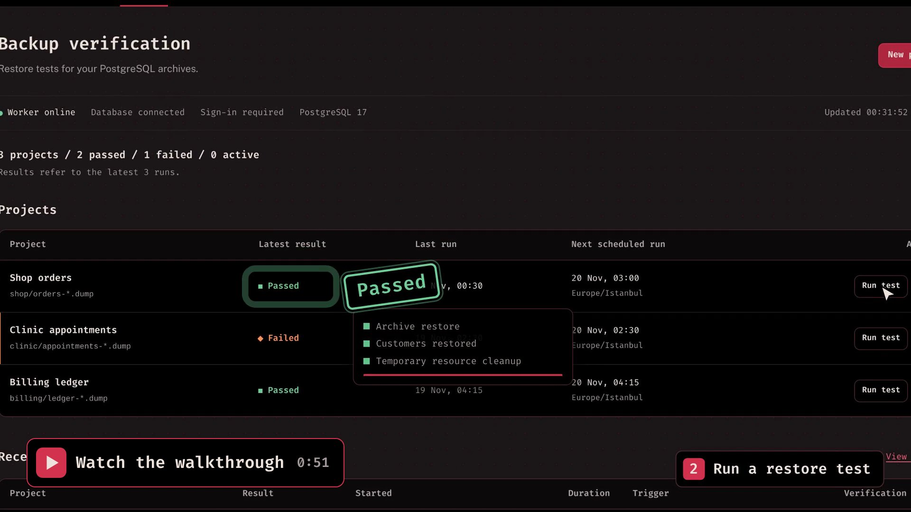
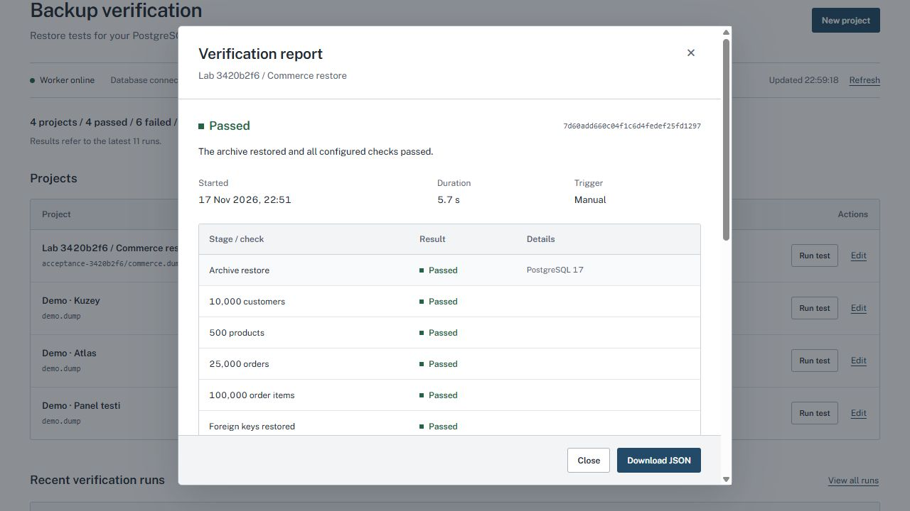
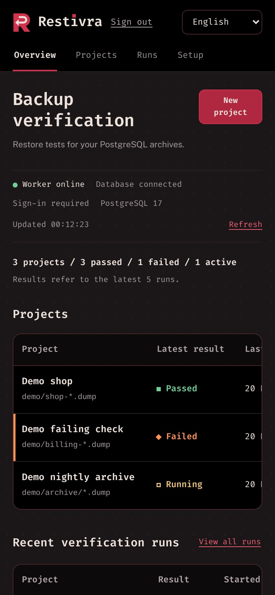

<h1 align="center"></h1>

[](https://github.com/lazypanic999/restivra/actions/workflows/ci.yml)
[](LICENSE)

**Restore your PostgreSQL backups. Run your checks. Keep the evidence.**

Self-hosted PostgreSQL 17 backup verification for small teams and agencies. Restivra restores existing custom-format dumps into temporary, network-isolated containers, executes read-only SQL checks, records the results, and removes temporary resources.

[Türkçe kurulum ve kullanım](README.tr.md)

The interface defaults to **English**. Select **Türkçe** to switch; the preference is remembered locally. See the [design review](docs/DESIGN-REVIEW.md) and [real PostgreSQL acceptance results](docs/POSTGRES-ACCEPTANCE.md).

[](https://lazypanic999.github.io/restivra/)

The 51-second walkthrough creates a project, runs a restore test, opens the report and catches a stale backup whose newest row is three days old. It has sound.


| Report for a failed SQL check | Phone |
| --- | --- |
|  |  |

The video and all screenshots use synthetic demo projects. The [sign-in page](docs/screenshots/sign-in.jpg) and the [Turkish interface](docs/screenshots/dashboard-tr.jpg) have their own captures.

## Features

- React dashboard in English and Turkish: overview, project settings, recent runs, report details and JSON downloads.
- Search all retained runs with result/date filters, cursor pagination, shareable filter links and CSV exports.
- Browse archived projects and restore their settings/history with scheduling disabled.
- PostgreSQL-backed queue, immutable run settings, cancellation and one active run per project.
- One restore worker per application database, enforced by a PostgreSQL session advisory lock.
- Worker heartbeats and startup reconciliation of interrupted jobs, owned containers and private snapshots.
- Owned-resource reconciliation before work and while idle; stale attempt completions are rejected.
- Bounded automatic infrastructure recovery: three attempts, persisted backoff and downloadable attempt history.
- Daily schedules with explicit IANA time zones; missed intervals do not create a backlog.
- SHA-256 fingerprints, unchanged-file warnings and file-age warnings.
- Optional failure webhook, with three persisted delivery attempts and independent delivery status.
- Docker Compose installation; only the worker has Docker socket access.
- Standalone CLI for one-off verification.
- Access-token sign-in with eight-hour HttpOnly sessions on fresh installations.
- Readiness healthcheck, prerequisite diagnostics and metadata backup scripts.

This early MVP is ready for an unattended local developer pilot while the computer and Docker are running. A fixed-image two-hour run passed all 210 expected outcomes; separate Docker/metadata fault drills recovered automatically. See the [readiness evidence and limits](docs/PILOT-READINESS.md). A passing run establishes a logical restore and your selected checks, not complete application recovery, original permissions, PITR or backup freshness. Real customer pilots and payment validation remain to be done.

## Quick start

Requires Docker Engine / Docker Desktop with Linux containers and Docker Compose. Allow RAM for the application database plus a restore container (1536 MiB default restore limit).

```sh
git clone https://github.com/lazypanic999/restivra.git
cd restivra
sh scripts/setup.sh
docker pull postgres:17-bookworm
docker compose up --build -d
```

Windows / PowerShell 7.2+: use `./scripts/setup.ps1` instead of `sh scripts/setup.sh`.

Open **[http://127.0.0.1:7474](http://127.0.0.1:7474)** and sign in using `RESTIVRA_AUTH_TOKEN` from your private `.env` file. New installations have an empty workspace. English is the default; Turkish is available in the header.

Giving Restivra to another developer? Use the [pinned pilot handoff](docs/PILOT-START.md)
or [Turkish participant guide](docs/PILOT-START.tr.md), including Docker-only smoke
tests, a seven-day plan and a private feedback form. For operations and recovery,
read the [pilot runbook](docs/PILOT-RUNBOOK.md). The [readiness review](docs/PILOT-READINESS.md)
separates completed checks from remaining production work.

1. Put a completed custom-format dump in `backups/`. Only PostgreSQL **17**, dumped with **pg_dump 17** and `-Fc`, is supported.
2. Create a project with a relative path such as `customer/*.dump`.
3. Add optional boolean SQL checks and a daily schedule.
4. Run a test and inspect its report.

For multiple matches, the newest file modification time wins; filename order breaks ties. Write backups to a different temporary extension, then atomically rename into the selected pattern when complete. The file-copy size/mtime checks detect some concurrent writes but cannot establish that the backup producer has finished.

### SQL checks

```sql
SELECT count(*) > 0 FROM public.customers
```

Checks return one non-null boolean from a single SELECT. Semicolons, comments and backslashes are deliberately unsupported. Queries use a restricted role in a read-only transaction with a 10-second statement timeout and a 2-second lock timeout. Row-level security is not bypassed.

### Synthetic demo

For the pilot, PowerShell 7.2+ users can run `./scripts/pilot-smoke.ps1` against
the running Compose installation. It needs Docker but no host Go/Node, creates a
real synthetic archive and two unique Pilot projects, and checks passing/failing
SQL outcomes plus cleanup. Schedules remain disabled; inspect then archive the samples.

The older developer demo, `./scripts/seed-demo.ps1`, needs Go 1.27.4+ and creates
two projects labeled **Demo**. `./scripts/demo.ps1` runs only the standalone CLI demonstration.

## Configuration

Setup generates `.env` with independent random database/access credentials and a unique instance name. Existing `.env` files are preserved. Do not commit `.env`, dumps, reports or runtime data.

| Variable | Default / meaning |
| --- | --- |
| `POSTGRES_PASSWORD` | Generated by setup; required by Compose. Keep the generated hex format. |
| `RESTIVRA_AUTH_TOKEN` | Random 256-bit access token generated by setup. Empty disables authentication for legacy local-only installations. |
| `RESTIVRA_INSTANCE` | Generated unique name; keep stable. Docker resource ownership uses an independent database installation ID. |
| `RESTIVRA_PORT` | `7474`; Compose host port, always bound to 127.0.0.1. |
| `RESTIVRA_RETENTION_DAYS` | `30`; completed-job retention, 1–3650 days. Pending notifications are retained. |
| `RESTIVRA_WEBHOOK_URL` | Optional public HTTPS webhook on port 443. |
| `RESTIVRA_DATABASE_URL` | Required for direct service execution; supplied by Compose. |
| `RESTIVRA_BACKUP_ROOT` | `backups` directly; `/backups` in Compose. |
| `RESTIVRA_WORK_DIR` | `work/jobs` directly; `/work/jobs` in Compose. |
| `RESTIVRA_ALLOWED_HOSTS` | `localhost:7474,127.0.0.1:7474,[::1]:7474`; exact HTTP host allowlist. |

Per-project defaults: 180-second run, 256 MiB archive, 512 MiB temporary database, 1536 MiB container memory, 1 CPU and 128 PIDs. The temporary database is RAM-backed and counts toward the memory limit. Increasing archive size does not increase restored-data capacity. One private archive copy also needs local disk space.

Webhooks receive generic JSON: `event`, `job_id`, `project`, `status`, `text`. SQL, archive data and credentials are excluded. Receivers may need a payload adapter. Redirects, proxies, private/special IP addresses and DNS results containing private addresses are rejected. Failed attempts retry after approximately 1 then 2 minutes, three attempts total. URLs stay in the worker environment rather than project records or reports.

## Architecture

```text
React dashboard → Go API → PostgreSQL projects/jobs
                                  ↑
                         Go worker + scheduler
                                  ↓
                    temporary PostgreSQL container
                      restore → checks → cleanup
```

The API has no Docker socket or backup mount. Worker files are opened with `os.Root`, rejecting traversal and symlinks escaping the backup root. Archives stream into restore containers; neither host paths nor the Docker socket are mounted there.

Jobs snapshot the project name, path and checks. Edits affect future jobs. Already-active projects are not scheduled twice. On worker restart, interrupted attempts are preserved and owned resources reconciled. Eligible jobs retry automatically, at most three attempts with 30/60-second delays; only a fresh successful restore can pass. Invalid archives, failed SQL checks, resource failures and restore-stage timeouts stay final. Cancellation suppresses retries. Notification delivery state is separate. See [recovery behavior and evidence](docs/DOCKER-STALL-ANALYSIS.md).

Recovery uses the metadata database's installation ID and exact legacy running-job IDs. It does not delete another installation's resources based on a shared instance name. Failed cleanup stops the worker before it claims another job; restart reconciles remaining resources first.

History searches all retained runs with cursor pages; overview counters cover all retained outcomes. The project list displays up to 500 records per active/archived view. Archiving preserves history until retention removes it.

## Access and trust boundary

- Compose exposes the panel on **127.0.0.1 only**. Fresh setups require the generated access token. For remote servers, use `ssh -L 7474:127.0.0.1:7474 user@server`. This is a single-operator installation, without user accounts or tenant separation; public hosting is outside the tested pilot profile.
- Sessions are signed, HttpOnly, SameSite=Strict cookies lasting eight hours. Access tokens are never returned by the API or stored in browser localStorage. Login allows ten attempts per peer per minute. Sign out removes the browser cookie; rotating the root token and recreating the API invalidates all existing sessions. Legacy `.env` files remain unchanged and may have authentication disabled.
- Host/origin checks, a per-process CSRF token, fetch metadata, CSP and no CORS protect browser access; they are not authentication. Local processes and Docker administrators remain trusted.
- Restore only trusted, authorized dumps. Dumps can execute SQL/functions as the restore administrator. Containers are not a complete boundary for hostile input. This is not an untrusted multi-tenant SaaS architecture.
- Restore containers have no external network or published ports, run non-root, drop capabilities, use a read-only root filesystem and enforce resource limits. The **worker Docker socket is host-administrative access**; protect the host and worker configuration.
- Original ownership, grants and roles are not restored. Custom extensions may fail with the standard image. Physical backups and PITR are outside scope.
- File mtime is not a verified backup creation timestamp. Unchanged SHA-256 and old-file warnings describe observations, not recovery-point guarantees.
- Raw PostgreSQL output is not retained because errors may contain customer data; error summaries are intentionally general.
- Safe error codes and suggested actions cover common failures. An abruptly closed PostgreSQL connection can hide the original cause, so some capacity failures retain the generic `restore_failed` code.
- Snapshots are deleted, not securely erased. Consider encrypted host storage. Windows privacy also depends on inherited NTFS ACLs.
- Image tags can change. The exact local image ID used is recorded; pull updates deliberately and rerun tests.

## CLI and development

Requirements: Go 1.27.4+, Node.js 24, npm, Docker Linux engine.

Operational checks: `docker compose exec worker restivra doctor --role worker` checks prerequisites without restoring data; `docker compose exec api restivra healthcheck` checks API/database readiness. Worker heartbeat remains a separate signed-in API/UI signal. Export Restivra's own metadata using `sh scripts/metadata-backup.sh /private/metadata.dump` or `./scripts/metadata-backup.ps1 -OutputPath work/metadata.dump`; these do not back up customer archives or `.env`.

```sh
cd web
npm ci
npm run build
cd ..
go build -o work/restivra ./cmd/restivra
go run ./cmd/restivra verify --backup /path/customer.dump --config config.example.json --report work/report-001.json
```

Windows binary output: `work/restivra.exe`. Reports must not already exist. Without `--config`, only restore/connection checks run. CLI exit codes: `0` passed, `1` verification/runtime failure, `2` invalid command/config. Use a compiled binary for automation; `go run` wraps failure exits.

To run services directly, set `RESTIVRA_DATABASE_URL`, then run `restivra serve` and `restivra worker` separately. Only the worker needs Docker/backup access. Production assets are bundled with esbuild and embedded at Go build time; rebuild Go after production frontend changes.

For local frontend development, run `npm --prefix web run dev` in one terminal, then `go run ./cmd/restivra serve --assets-dir internal/webui/dist` in another (with the database environment configured). The first command watches imported JavaScript/CSS/fonts; it opens no HTTP port. The Go server reads compiled files from disk at the existing `127.0.0.1:7474` origin, keeping the host/origin/CSRF protections. Refresh the browser after a rebuild; there is no HMR. Restart the watcher after editing the HTML template or public files. Without `--assets-dir`, the server always uses embedded production assets.

`npm audit --audit-level=low` checks **all** frontend dependencies, including development tools, and is enforced in CI. See [the build-security migration](docs/BUILD-SECURITY.md).

```sh
go test ./...
go vet ./...
docker pull postgres:17-bookworm
RESTIVRA_INTEGRATION=1 go test -p 1 ./... -count=1 -timeout=10m
```

PowerShell: set `$env:RESTIVRA_INTEGRATION = '1'` before `go test`. Integration tests use real PostgreSQL containers and cover restores, corrupt input, failing/null checks, blocked writes, deadlines, cleanup, persistent jobs, duplicate prevention, scheduling, cancellation and restart recovery. CI runs them on Linux.

## Operations

Use **Runs** to search all retained history, including archived sources, and download up to 10,000 matching rows as CSV. Filters use queue time in your device time zone; exports use UTC. **Projects → Archived projects** restores a source with daily scheduling disabled. The overview counts all retained outcomes and displays six recent rows. See [history, exports and project recovery](docs/HISTORY.md).

```sh
docker compose logs --tail=100 api worker
docker compose restart worker
docker compose down
```

`down` preserves volumes. Metadata lives in `app-data`; private worker snapshots use `worker-data`. Back up the application database separately if history matters. `down -v` discards those volumes.

After a hard kill, restart the worker to reconcile service-managed resources automatically. Keep `RESTIVRA_INSTANCE` stable. For standalone CLI runs:

```sh
docker ps -a --filter label=app=restivra --format '{{.Names}}'
go run ./cmd/restivra cleanup --run-id <32-character-run-id>
```

Manual cleanup verifies the exact ownership label. Do not target active jobs. Hard-killed standalone snapshots may need removal from their CLI work directory; worker recovery does not touch unrelated CLI work.

## Brand


The logo is a crimson R whose counter is a cream return arrow. The palette is crimson `#d2324d`, cream `#ede3dc` and black, and interface text is set in Fira Code. The badger from the walkthrough is the project mascot.

Logo, mark, favicon sources and the mascot are in [docs/brand](docs/brand). Interface rules, including the dark character layer, are in [DESIGN.md](DESIGN.md).

The badger also has [six transparent expression poses](docs/branding): sleeping, proud, panicking, refusing, approving and waving, with a downloadable PNG pack and generation prompts.

## Contributing and license

Restivra is available under the [MIT license](LICENSE). See
[CONTRIBUTING.md](CONTRIBUTING.md) for development checks and issue guidelines,
[SECURITY.md](SECURITY.md) for private vulnerability reporting, and
[third-party notices](THIRD_PARTY_NOTICES.md) for dependency licenses.
Changes awaiting a tagged release are listed in the [changelog](CHANGELOG.md).

## Remaining work

Real developer pilots on their own computers, extension compatibility, larger-database sizing and payment validation. S3, PDF, extra database engines/major versions, PITR and hosted multi-tenant operation are outside the MVP. See [ROADMAP.md](ROADMAP.md).

References: [pg_restore](https://www.postgresql.org/docs/17/app-pgrestore.html), [advisory locks](https://www.postgresql.org/docs/17/explicit-locking.html#ADVISORY-LOCKS), [Docker run](https://docs.docker.com/reference/cli/docker/container/run/).
