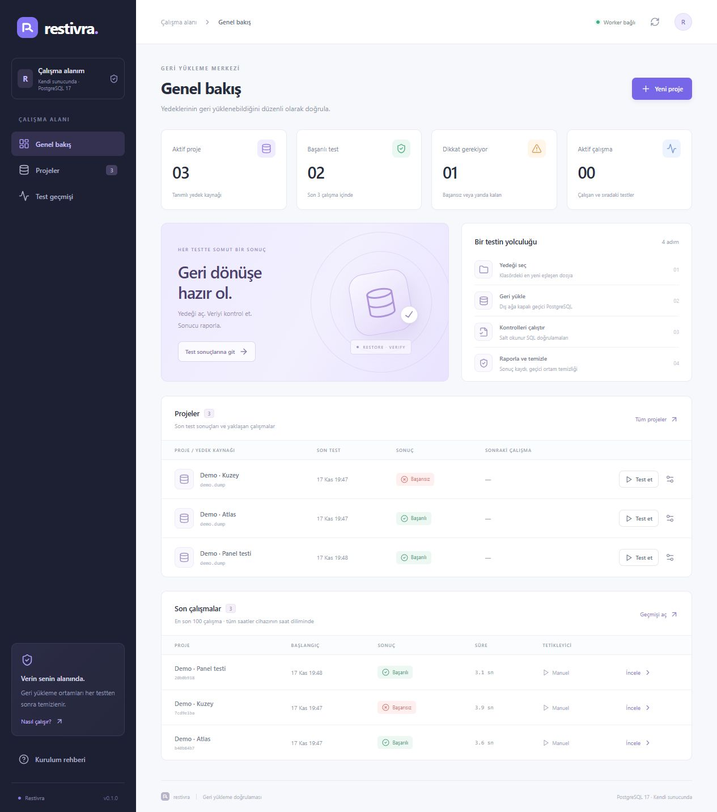

# Restivra

[](https://github.com/lazypanic999/restivra/actions/workflows/ci.yml)

**Restore your PostgreSQL backups. Run your checks. Keep the evidence.**

Self-hosted PostgreSQL 17 backup verification for small teams and agencies. Restivra restores existing custom-format dumps into temporary, network-isolated containers, executes read-only SQL checks, records the results, and removes temporary resources.

[Türkçe kurulum ve kullanım](README.tr.md)

The interface defaults to **English**. Select **Türkçe** to switch; the preference is remembered locally. See the [design review](docs/DESIGN-REVIEW.md) and [real PostgreSQL acceptance results](docs/POSTGRES-ACCEPTANCE.md).



## Features

- React dashboard: overview, project settings, recent runs, report details and JSON downloads.
- PostgreSQL-backed queue, immutable run settings, cancellation and one active run per project.
- One restore worker per application database, enforced by a PostgreSQL session advisory lock.
- Worker heartbeats and startup reconciliation of interrupted jobs, owned containers and private snapshots.
- Daily schedules with explicit IANA time zones; missed intervals do not create a backlog.
- SHA-256 fingerprints, unchanged-file warnings and file-age warnings.
- Optional failure webhook, with three persisted delivery attempts and independent delivery status.
- Docker Compose installation; only the worker has Docker socket access.
- Standalone CLI for one-off verification.

This is an early MVP. A passing run establishes a logical restore and your selected checks, not complete application recovery, original permissions, PITR or backup freshness. Real customer pilots and payment validation remain to be done.

## Quick start

Requires Docker Engine / Docker Desktop with Linux containers and Docker Compose. Allow RAM for the application database plus a restore container (1536 MiB default restore limit).

```sh
git clone https://github.com/lazypanic999/restivra.git
cd restivra
sh scripts/setup.sh
docker pull postgres:17-bookworm
docker compose up --build -d
```

Windows / PowerShell 7: use `./scripts/setup.ps1` instead of `sh scripts/setup.sh`.

Open **[http://127.0.0.1:7474](http://127.0.0.1:7474)**. New installations have an empty workspace.

1. Put a completed custom-format dump in `backups/`. Only PostgreSQL **17**, dumped with **pg_dump 17** and `-Fc`, is supported.
2. Create a project with a relative path such as `customer/*.dump`.
3. Add optional boolean SQL checks and a daily schedule.
4. Run a test and inspect its report.

For multiple matches, the newest file modification time wins; filename order breaks ties. Write backups to a different temporary extension, then atomically rename into the selected pattern when complete. The file-copy size/mtime checks detect some concurrent writes but cannot establish that the backup producer has finished.

### SQL checks

```sql
SELECT count(*) > 0 FROM public.customers
```

Checks return one non-null boolean from a single SELECT. Semicolons, comments and backslashes are deliberately unsupported. Queries use a restricted role in a read-only transaction with a 10-second statement timeout and a 2-second lock timeout. Row-level security is not bypassed.

### Synthetic demo

With Go 1.25+ installed, run `./scripts/seed-demo.ps1` in PowerShell. It creates an actual dump with synthetic customers and queues two projects labeled **Demo**: one passes and one intentionally fails its data check. Demo schedules stay disabled. `./scripts/demo.ps1` runs only the standalone CLI demonstration.

## Configuration

Setup generates `.env` with a random database password. Do not commit `.env`, dumps, reports or runtime data.

| Variable | Default / meaning |
| --- | --- |
| `POSTGRES_PASSWORD` | Generated by setup; required by Compose. Keep the generated hex format. |
| `RESTIVRA_INSTANCE` | `restivra-main`; unique and stable per installation sharing a Docker engine. |
| `RESTIVRA_RETENTION_DAYS` | `30`; completed-job retention, 1–3650 days. Pending notifications are retained. |
| `RESTIVRA_WEBHOOK_URL` | Optional public HTTPS webhook on port 443. |
| `RESTIVRA_DATABASE_URL` | Required for direct service execution; supplied by Compose. |
| `RESTIVRA_BACKUP_ROOT` | `backups` directly; `/backups` in Compose. |
| `RESTIVRA_WORK_DIR` | `work/jobs` directly; `/work/jobs` in Compose. |
| `RESTIVRA_ALLOWED_HOSTS` | `localhost:7474,127.0.0.1:7474,[::1]:7474`; exact HTTP host allowlist. |

Per-project defaults: 180-second run, 256 MiB archive, 512 MiB temporary database, 1536 MiB container memory, 1 CPU and 128 PIDs. The temporary database is RAM-backed and counts toward the memory limit. Increasing archive size does not increase restored-data capacity. One private archive copy also needs local disk space.

Webhooks receive generic JSON: `event`, `job_id`, `project`, `status`, `text`. SQL, archive data and credentials are excluded. Receivers may need a payload adapter. Redirects, proxies, private/special IP addresses and DNS results containing private addresses are rejected. Failed attempts retry after approximately 1 then 2 minutes, three attempts total. URLs stay in the worker environment rather than project records or reports.

## Architecture

```text
React dashboard → Go API → PostgreSQL projects/jobs
                                  ↑
                         Go worker + scheduler
                                  ↓
                    temporary PostgreSQL container
                      restore → checks → cleanup
```

The API has no Docker socket or backup mount. Worker files are opened with `os.Root`, rejecting traversal and symlinks escaping the backup root. Archives stream into restore containers; neither host paths nor the Docker socket are mounted there.

Jobs snapshot the project name, path and checks. Edits affect future jobs. Already-active projects are not scheduled twice. On worker restart, interrupted jobs are reconciled and marked `interrupted`, not successful. Notification delivery state is separate.

History returns the latest 100 runs; overview counters describe that window. The project list displays up to 500 records. Archiving preserves history until retention removes it.

## Access and trust boundary

- Compose exposes the panel on **127.0.0.1 only**. There is no user authentication. For remote servers, use `ssh -L 7474:127.0.0.1:7474 user@server`. Do not expose it publicly without an appropriate authentication layer.
- Host/origin checks, a per-process CSRF token, fetch metadata, CSP and no CORS protect browser access; they are not authentication. Local processes and Docker administrators remain trusted.
- Restore only trusted, authorized dumps. Dumps can execute SQL/functions as the restore administrator. Containers are not a complete boundary for hostile input. This is not an untrusted multi-tenant SaaS architecture.
- Restore containers have no external network or published ports, run non-root, drop capabilities, use a read-only root filesystem and enforce resource limits. The **worker Docker socket is host-administrative access**; protect the host and worker configuration.
- Original ownership, grants and roles are not restored. Custom extensions may fail with the standard image. Physical backups and PITR are outside scope.
- File mtime is not a verified backup creation timestamp. Unchanged SHA-256 and old-file warnings describe observations, not recovery-point guarantees.
- Raw PostgreSQL output is not retained because errors may contain customer data; error summaries are intentionally general.
- Snapshots are deleted, not securely erased. Consider encrypted host storage. Windows privacy also depends on inherited NTFS ACLs.
- Image tags can change. The exact local image ID used is recorded; pull updates deliberately and rerun tests.

## CLI and development

Requirements: Go 1.25+, Node.js 24, npm, Docker Linux engine.

```sh
cd web
npm ci
npm run build
cd ..
go build -o work/restivra ./cmd/restivra
go run ./cmd/restivra verify --backup /path/customer.dump --config config.example.json --report work/report-001.json
```

Windows binary output: `work/restivra.exe`. Reports must not already exist. Without `--config`, only restore/connection checks run. CLI exit codes: `0` passed, `1` verification/runtime failure, `2` invalid command/config. Use a compiled binary for automation; `go run` wraps failure exits.

To run services directly, set `RESTIVRA_DATABASE_URL`, then run `restivra serve` and `restivra worker` separately. Only the worker needs Docker/backup access. Production assets are bundled with esbuild and embedded at Go build time; rebuild Go after production frontend changes.

For local frontend development, run `npm --prefix web run dev` in one terminal, then `go run ./cmd/restivra serve --assets-dir internal/webui/dist` in another (with the database environment configured). The first command watches imported JavaScript/CSS/fonts; it opens no HTTP port. The Go server reads compiled files from disk at the existing `127.0.0.1:7474` origin, keeping the host/origin/CSRF protections. Refresh the browser after a rebuild; there is no HMR. Restart the watcher after editing the HTML template or public files. Without `--assets-dir`, the server always uses embedded production assets.

`npm audit --audit-level=low` checks **all** frontend dependencies, including development tools, and is enforced in CI. See [the build-security migration](docs/BUILD-SECURITY.md).

```sh
go test ./...
go vet ./...
docker pull postgres:17-bookworm
RESTIVRA_INTEGRATION=1 go test -p 1 ./... -count=1 -timeout=10m
```

PowerShell: set `$env:RESTIVRA_INTEGRATION = '1'` before `go test`. Integration tests use real PostgreSQL containers and cover restores, corrupt input, failing/null checks, blocked writes, deadlines, cleanup, persistent jobs, duplicate prevention, scheduling, cancellation and restart recovery. CI runs them on Linux.

## Operations

```sh
docker compose logs --tail=100 api worker
docker compose restart worker
docker compose down
```

`down` preserves volumes. Metadata lives in `app-data`; private worker snapshots use `worker-data`. Back up the application database separately if history matters. `down -v` discards those volumes.

After a hard kill, restart the worker to reconcile service-managed resources automatically. Keep `RESTIVRA_INSTANCE` stable. For standalone CLI runs:

```sh
docker ps -a --filter label=app=restivra --format '{{.Names}}'
go run ./cmd/restivra cleanup --run-id <32-character-run-id>
```

Manual cleanup verifies the exact ownership label. Do not target active jobs. Hard-killed standalone snapshots may need removal from their CLI work directory; worker recovery does not touch unrelated CLI work.

## Remaining work

Real agency pilots, extension compatibility, larger-database sizing and payment validation. S3, PDF, extra database engines/major versions, PITR and hosted multi-tenant operation are outside the MVP. See [ROADMAP.md](ROADMAP.md).

References: [pg_restore](https://www.postgresql.org/docs/17/app-pgrestore.html), [advisory locks](https://www.postgresql.org/docs/17/explicit-locking.html#ADVISORY-LOCKS), [Docker run](https://docs.docker.com/reference/cli/docker/container/run/).
