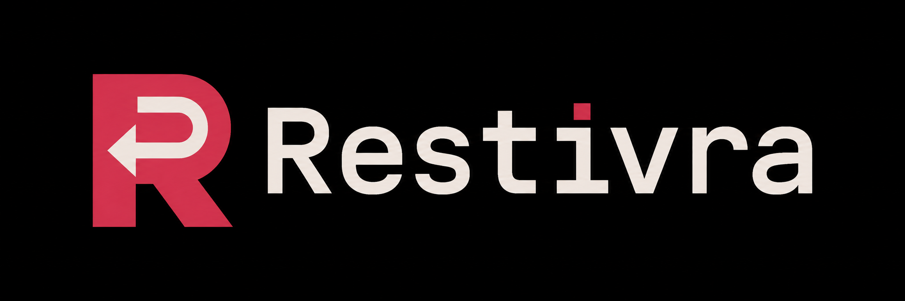
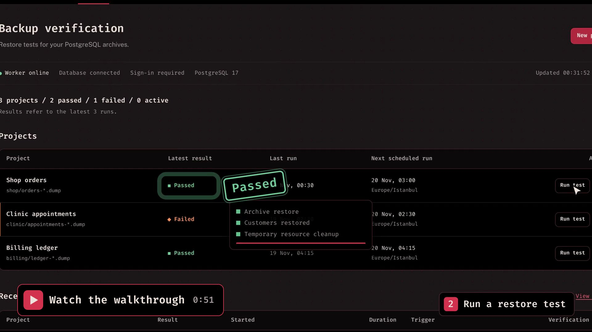
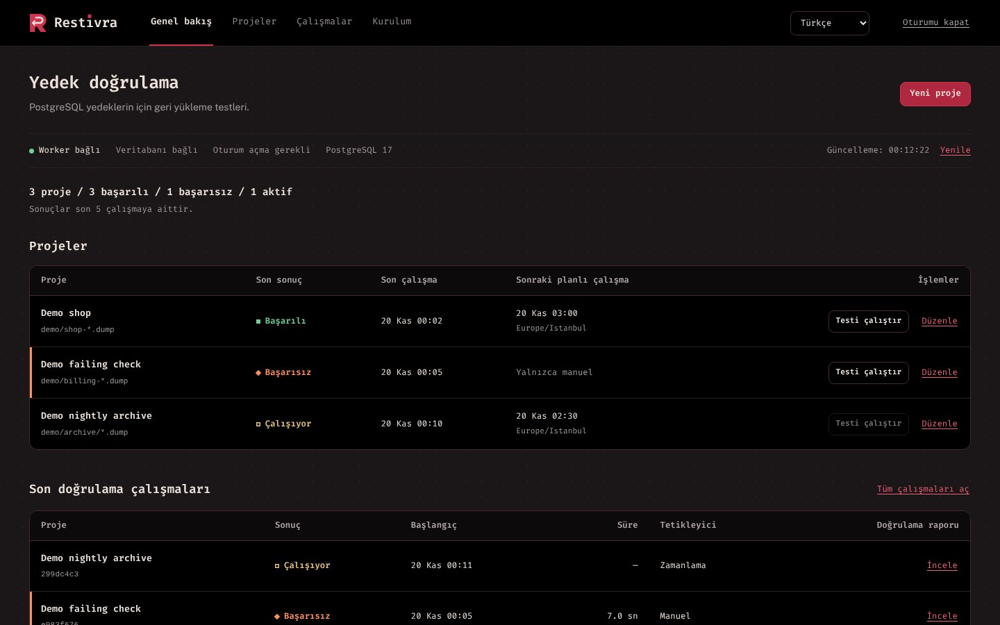

<h1 align="center"></h1>

# Restivra — Türkçe kullanım

[MIT lisansı](LICENSE) · [Katkı rehberi](CONTRIBUTING.md) · [Güvenlik bildirimi](SECURITY.md) · [Üçüncü taraf lisansları](THIRD_PARTY_NOTICES.md)

Arayüz varsayılan olarak **İngilizce** açılır. Sağ üstteki dil seçicisinden **Türkçe** seçebilirsin; tercihin tarayıcıda saklanır. Yeni tasarım ve gerçek PostgreSQL denemesinin ayrıntıları: [tasarım incelemesi](docs/DESIGN-REVIEW.md), [sekiz senaryolu kabul testi](docs/POSTGRES-ACCEPTANCE.md).

Mevcut PostgreSQL 17 yedeğini geçici bir ortamda geri yükler, SQL kontrollerini çalıştırır ve sonucu raporlar. İlk pilot, geliştiricinin kendi bilgisayarında Docker Desktop ile çalıştırması için hazırlanmıştır.

[](https://lazypanic999.github.io/restivra/)

51 saniyelik tanıtım videosunda bir proje oluşturuluyor, geri yükleme testi çalıştırılıyor, rapor açılıyor ve en yeni kaydı üç gün önceye ait bayat bir yedek yakalanıyor. Video sesli ve İngilizce arayüzle çekildi.



Video ve görüntülerdeki projeler sentetik demo verisidir. Başarısız bir SQL kontrolünün raporu için [rapor ekranına](docs/screenshots/report.jpg), telefon görünümü için [mobil ekrana](docs/screenshots/dashboard-mobile.jpg) bakabilirsin.

## Kurulum

Docker'ın Linux konteyner motoru açık olmalı. PowerShell 7.2+:

```powershell
git clone https://github.com/lazypanic999/restivra.git
cd restivra
./scripts/setup.ps1
docker pull postgres:17-bookworm
docker compose up --build -d
```

Linux'ta kurulum betiği `sh scripts/setup.sh`. Panel: **[http://127.0.0.1:7474](http://127.0.0.1:7474)**.

Yeni kurulumda özel `.env` dosyasındaki `RESTIVRA_AUTH_TOKEN` ile giriş yap. Mevcut `.env` değiştirilmez; eski kurulumda anahtar yoksa oturum açma kapalı kalır. Başka bir geliştiriciye vermek için [sabit sürümlü pilot başlangıç rehberi](docs/PILOT-START.tr.md), [yedi günlük plan](docs/PILOT-PLAN.tr.md) ve [özel kayıt formu](docs/PILOT-RECORD.tr.md) hazır. Ayrıntılı kurtarma için [pilot işletim rehberi](docs/PILOT-RUNBOOK.md).

Teslim durumu: bilgisayar ve Docker açıkken gözetimsiz yerel geliştirici pilotuna hazır. Sabit imajla iki saatlik testte 210 beklenen sonuç doğrulandı; ayrıca Docker takılması ve metaveri bağlantı kaybından otomatik toparlandı. Önceki 97. dakika hatası ve Windows'taki kesin tetikleyicinin hâlâ belirsiz olması [hazırlık incelemesinde](docs/PILOT-READINESS.md) korunuyor. Dış kullanıcıyla bir haftalık pilot henüz yapılmadı. Bilgisayar/Docker kapalıyken test çalışmaz.

## İlk proje

1. PostgreSQL 17 üzerinde `pg_dump` 17 ile `-Fc` formatında alınmış tamamlanmış yedeği `backups/` klasörüne koy.
2. Panelde **Yeni proje** seç. Dosya yolunu klasöre göre yaz: örneğin `musteri/*.dump`.
3. İstersen tek boolean döndüren kontrol ekle: `SELECT EXISTS (SELECT 1 FROM public.customers)`. Noktalı virgül kullanma.
4. **Test et** ile başlat. Raporunda geri yükleme, kontroller ve temizliği ayrı incele.
5. Günlük otomatik test için proje ayarlarında saat ve saat dilimi belirle.

Birden fazla eşleşmede değiştirilme zamanı en yeni dosya seçilir. Yedeği önce başka uzantıya yazıp tamamlandığında seçilen ada atomik taşı. Dosya değiştirilme zamanı, yedeğin alınma zamanının kesin kanıtı değildir.

Go/Node kurmadan örnek deneme için PowerShell 7.2+ ile `./scripts/pilot-smoke.ps1`
çalıştır. Gerçek PostgreSQL yedeğinden iki benzersiz **Pilot** projesi oluşturur;
biri geçer, diğeri kasıtlı yanlış kontrolden kalır. Geri yükleme ve temizliği
doğrular; zamanlamalar kapalı kalır. İnceledikten sonra örnekleri arşivle.
Eski `./scripts/seed-demo.ps1` geliştirici demosu ise Go 1.27.4+ ister.

## MVP'de bulunanlar

Restivra'nın kendi metaveri yedeğini ayrı PostgreSQL'de denemek için
`./scripts/metadata-check.ps1 -Archive work/state.dump` kullanılabilir. Mevcut
veritabanına dokunmaz; klon worker başlatmadan tabloları, ilişkileri ve sayıları
kontrol eder. [Metaveri doğrulama rehberi](docs/METADATA-CHECK.md).

Proje formundaki hazır kontrol şablonları kayıt sayısı, güncel uygulama verisi ve
gerekli sütunlar için düzenlenebilir SQL üretir. Önizlemeyi şemana göre inceleyip
ekleyebilirsin; [şablonların kapsamı ve sınırları](docs/CHECK-TEMPLATES.md).

`main` sürümünde S3 uyumlu bucket'tan doğrulama da var: `private/sources.json`
içinde salt okunur worker profili tanımlanır, proje formundan seçilir. Anahtarlar
API'ye veya proje veritabanına girmez. [Yapılandırma ve sınırlar](docs/S3-SOURCES.md).
Sabit `v0.1.0-pilot.1` etiketi önceki yerel dosya pilotudur; değiştirilmedi.

- Genel bakış, proje ayarları, saklanan geçmişin tamamında arama, tarih/sonuç filtresi, sayfalama, rapor ve JSON indirme.
- Filtrelenmiş geçmişi CSV olarak indirme; arşivlenmiş projeyi zamanlaması kapalı biçimde geri getirme.
- [Önceki çalışmayla karşılaştırma](docs/RUN-COMPARISON.md); sorgu değişikliği, kötüleşme ve düzelme ayrı gösterilir.
- [Proje ayarlarını dışa/içe aktarma](docs/PROJECT-TRANSFER.md); inceleme formu açılır, zamanlama kapalı başlar.
- [İngilizce/Türkçe yazdırılabilir kanıt](docs/EVIDENCE-REPORTS.md); isimleri gizleme ve tarayıcıdan PDF kaydetme.
- Kalıcı PostgreSQL iş kuyruğu; aynı anda tek geri yükleme.
- Proje başına tek aktif iş, manuel/günlük çalışma ve iptal.
- Worker yeniden başlayınca yarım işlerin ve geçici kaynakların toparlanması.
- Geçici altyapı hatalarında 30/60 saniye arayla en fazla üç otomatik deneme; önceki denemeler ve raporları korunur.
- SHA-256, değişmeyen yedek ve eski dosya uyarıları.
- İsteğe bağlı başarısızlık webhook'u; en fazla üç teslim denemesi.
- Varsayılan 30 günlük tamamlanmış çalışma geçmişi.
- Yeni kurulumda erişim anahtarıyla giriş, sekiz saatlik HttpOnly oturum ve çıkış.
- Kurulum tanısı, API sağlık kontrolü ve Restivra metaverisini yedekleme betikleri.

## Sınırlar

Panel yerel erişim içindir; yeni kurulumda ortak erişim anahtarıyla oturum açılır. Uzak sunucu için `ssh -L 7474:127.0.0.1:7474 user@server` kullan. Denenen pilot profili, kendi sunucusunda teknik kullanıcının işlettiği tek kurulumdur. Kullanıcı hesabı ve kiracı ayrımı yoktur.

Yalnızca güvendiğin ve yetkili olduğun yedeklerle çalış. Dump çalıştırılabilir SQL içerebilir; konteyner düşmanca girdi için tam izolasyon değildir. Docker yetkisi yalnızca worker'dadır ve host üzerinde güçlü yetkidir.

Başarılı sonuç; mantıksal geri yükleme ve tanımlı sorguların geçtiğini gösterir. Tam uygulama kurtarması, orijinal roller/yetkiler, PITR ve güncellik ayrıca doğrulanmalıdır. Özel eklenti ve diğer ana sürümler bu kapsamda yoktur.

`.env` rastgele veritabanı parolası içerir; Git'e alınmaz. Yedek ve raporları da repoya ekleme. Varsayılan restore ortamı 1536 MiB bellek ve 512 MiB RAM tabanlı veri alanı kullanır; sıkıştırılmış yedek daha büyük bir veritabanına açılabilir.

## İşletim

```powershell
docker compose logs --tail=100 api worker
docker compose restart worker
docker compose down
```

`down` veriyi korur; `down -v` geçmiş dahil named volume'leri siler. `RESTIVRA_INSTANCE` sabit kalmalı. Geçici kaynak sahipliği ayrıca veritabanına özel kurulum kimliğiyle doğrulanır. Temizlik başarısızsa worker yeni iş almadan durur; yeniden başlarken kalan kaynakları toparlar.

**Çalışmalar** son 100 kayıtla sınırlı değildir. Tarihler sıraya alınma zamanına ve cihazının saat dilimine göredir; bitiş günü dahildir. Filtreler bağlantıda korunur. CSV indirme tüm eşleşmeleri kapsar; en fazla 10.000 kayıt için filtreyi daraltabilirsin. CSV zamanları UTC'dir. **Projeler → Arşivlenmiş projeler** içinden kaynak geri getirilebilir; kontrolleri ve geçmişi korunur, günlük zamanlama kapalı kalır. [Kullanım ve API](docs/HISTORY.md).

Worker yeni iş öncesinde ve boşta yaklaşık 30 saniyede bir sahip olduğu geçici kaynakları kontrol eder. İptalden sonra gecikerek oluşan konteyner ve kopyaları yeniden başlamadan temizler. Önceki denemenin gecikmiş sonucu yeni bir denemenin üzerine yazılamaz.

`docker compose exec worker restivra doctor --role worker` ön gereksinimleri kontrol eder. `docker compose exec api restivra healthcheck` API/veritabanı hazır olma kontrolüdür; worker bağlantısını ayrıca panelden izle. Proje ve rapor veritabanını yedeklemek için `./scripts/metadata-backup.ps1 -OutputPath work/metadata.dump` kullan; Linux karşılığı `sh scripts/metadata-backup.sh /private/metadata.dump`. Bu arşiv müşteri dump'larını ve `.env` dosyasını içermez.

Bildirim için `.env` içindeki `RESTIVRA_WEBHOOK_URL` değerine genel JSON kabul eden açık HTTPS adresi yazıp worker'ı yeniden oluştur. Yerel/özel ağlar ve yönlendirmeler engellenir. Bildirim hatası test sonucunu değiştirmez.

Ayrıntılı mimari, yapılandırma ve testler: [README.md](README.md).

## Arayüz geliştirme ve bağımlılık güvenliği

Vite ve sorunlu glob bağımlılıkları kaldırıldı; derleme doğrudan esbuild ile yapılır. `npm --prefix web run build` üretim dosyalarını hazırlar. Geliştirmede bir terminalde `npm --prefix web run dev`, diğerinde veritabanı ortamı tanımlıyken `go run ./cmd/restivra serve --assets-dir internal/webui/dist` çalıştır. Arayüz ve API aynı `127.0.0.1:7474` adresindedir; ek sunucu/proxy yoktur.

İçe aktarılan JS/CSS/yazı tipi değişiklikleri otomatik derlenir; tarayıcıyı elle yenile. HTML şablonu veya public dosyaları değişince izleyiciyi yeniden başlat. Üretim varsayılanı, ikili içine gömülmüş dosyalardır.

Geliştirme araçları dahil tüm npm ağacı `npm audit --audit-level=low` ile CI'da denetlenir. [Güvenlik değişikliği](docs/BUILD-SECURITY.md).

## Marka


Logo, iç boşluğu krem renkli bir dönüş oku olan kırmızı bir R. Renkler kırmızı `#d2324d`, krem `#ede3dc` ve siyah; arayüz yazıları Fira Code. Tanıtım videosundaki porsuk projenin maskotu.

Logo, işaret, favicon kaynakları ve maskot [docs/brand](docs/brand) klasöründe. Koyu tema dahil arayüz kuralları [DESIGN.md](DESIGN.md) içinde.
