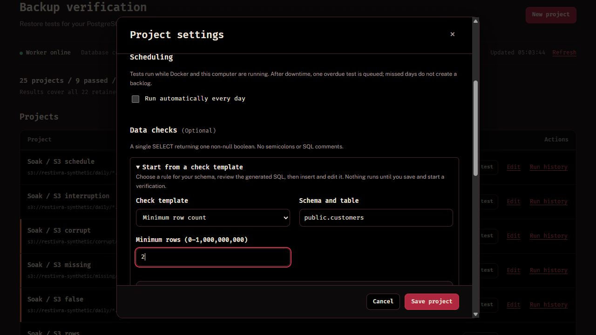

# Editable SQL check templates

In project settings, expand **Start from a check template**. Pick a rule, enter
your schema/table and review the SQL preview. **Insert editable check** adds it to
the usual check editor. You can change its name and query before saving. Repeated
insertions receive distinct names. Nothing executes inside the template builder.

| Rule | Input | Passes when |
| --- | --- | --- |
| Table contains rows | `public.orders` | At least one row exists |
| Minimum row count | Table and minimum, 0–1,000,000,000 | Row count meets the threshold |
| Recent application data | Table, timestamp column and maximum age, 1–8,760 hours | Maximum timestamp is within the age window and no more than five minutes in the future |
| Required columns exist | Table and up to 32 distinct column names | All named columns exist; additional columns are allowed |

Names support ASCII letters, digits and underscores, starting with a letter or
underscore, up to PostgreSQL's 63-byte identifier limit. Omitted schema means
`public`. Identifiers are quoted, so `Billing.Orders` preserves that case. Use
custom SQL for other quoted names. Template text never becomes unvalidated SQL.

For recency, use a `timestamptz` column representing meaningful application data.
An empty table, all-null timestamps, stale data and a maximum timestamp over five
minutes in the future fail. A recent timestamp does not prove completeness or
consistency across tables. A single accidental future row also fails this rule;
edit the query if your domain needs a different policy. The check compares against
the restore container's clock, not the backup file's modification time.

There is no live schema discovery. A typo or missing table becomes a check error
on the next verification. The existing read-only, single-boolean SELECT rules,
statement deadline and 32-check limit still apply. Unused builder fields do not
affect project validation or persist with the project.

New nonempty checks use `EXISTS`, and minimum-count checks count a subquery capped
at the requested threshold. They stop reading once enough rows are found.
Existing saved checks keep their original SQL. The PostgreSQL test inserts
100,000 rows and uses `EXPLAIN ANALYZE` to assert that the relation scans read at
most one row for existence and 25 rows for a threshold of 25. This checks the
amount of work directly, without relying on timing thresholds on a shared host.

## Validation

`npm test` covers identifier/number injection rejection and unique generated
names. With `RESTIVRA_INTEGRATION=1`, it also starts real PostgreSQL 17 and evaluates
empty, null, stale, current and future timestamps, row thresholds, required/missing
columns and extra columns in read-only transactions. CI runs this after pulling
the PostgreSQL image. The test removes only its uniquely named container.

A browser-created synthetic project also passed a real local archive restore
with two generated row checks. An invalid, unused minimum in the builder did not
block saving those valid checks. The feature is on `main`; the earlier
`v0.1.0-pilot.1` tag remains unchanged.
