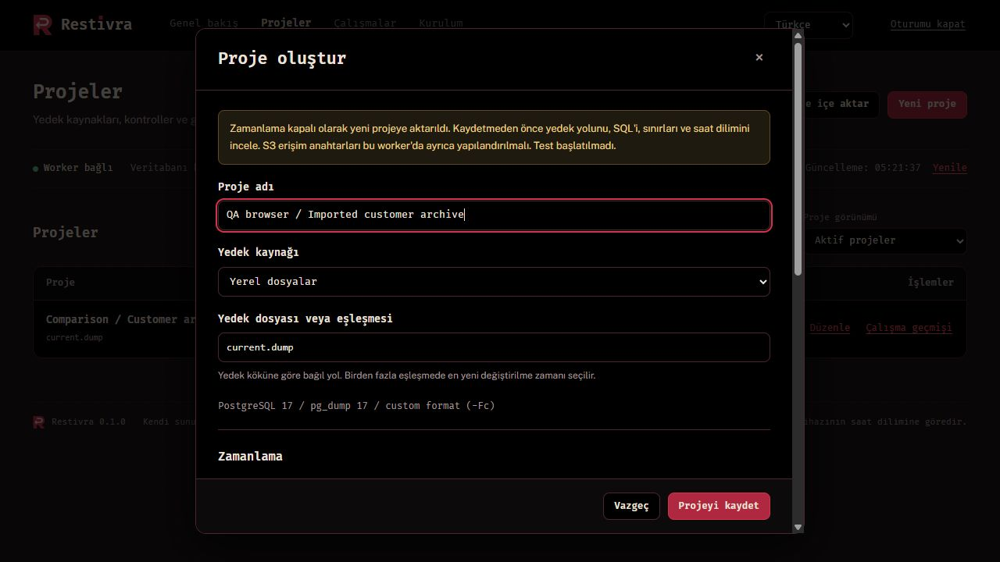

# Move project settings to another installation

Open a project's settings and choose **Export saved settings**. The downloaded
`restivra-project.json` includes its name, backup pattern/source selection,
resource limits, SQL checks, time zone and saved schedule. Unsaved edits are not
exported. Save and reopen first if you want to transfer your latest changes.

On the destination installation, open **Projects → Import project**, select the
file, review the resulting form and save. This creates a **new project** with a
new ID. It never updates a matching name or restores the original run history.
Renaming the imported copy can help distinguish it from an existing project.

Scheduling is always turned off on import, even if the file contains a daily
time. You can explicitly enable it after reviewing the destination. Importing or
saving with scheduling off does not start a test; use **Run test** when ready.

Review these destination-dependent settings:

- Local backup patterns are relative to the destination worker's backup root.
- S3 profile IDs must be configured separately in the destination worker's private
  profile file. Keys and provider endpoints are not transferred.
- SQL must match the archive's schema; resource limits must fit this computer.
- Select the intended time zone before enabling a daily schedule.

Keep the file private. It deliberately contains SQL and source names, which can
reveal schema, customer identifiers or literals embedded in your queries. Worker
credentials, project/run IDs, reports, restored rows and history are excluded.
This is a settings transfer, not a backup of Restivra's application database;
use the [metadata recovery procedure](PILOT-RUNBOOK.md) for full history recovery.

## File contract and validation

The versioned format is `{"format":"restivra.project.v1","project":{...}}`, with
a maximum size of 2 MiB. Other versions, unknown fields, credential/endpoint fields,
invalid structures, oversized strings and more than 32 checks are rejected
before the editor opens. Errors never display the file's contents. Import does
not send the file to the server until you review and save the form. Normal server
validation remains authoritative for SQL, source paths, names and resource limits.

The actual browser acceptance downloaded saved settings, copied that export with
a synthetic `23:00` schedule, imported it and confirmed the schedule was off.
The new project passed a real PostgreSQL 17 restore when manually started. A
second file containing a synthetic `secret_access_key` field was rejected; the
original project and its reports stayed intact. See [sanitized result](acceptance/comparison-20261120/transfer-browser.json).

