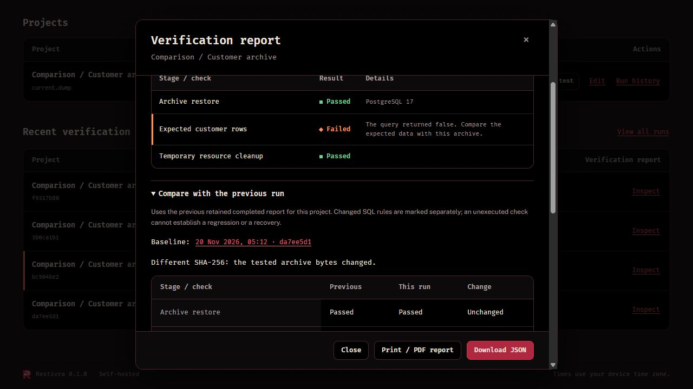
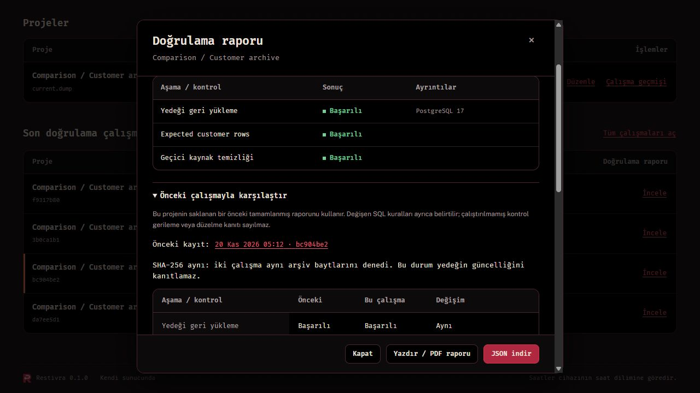

# Compare retained verification runs

Open a completed verification report and expand **Compare with the previous
run**. Restivra selects the previous retained completed report for the same
project, ordered by queue time and run ID. It skips queued/running jobs and
entries without a full report. The baseline link opens that original report.

The comparison uses immutable settings saved with each job. Editing the current
project does not rewrite historical comparisons.

| Change | Meaning |
| --- | --- |
| Unchanged | Same observed outcome under the same SQL text |
| Regressed | A previously passing check now failed or errored |
| Improved | A previously failing/errored check now passed |
| SQL rule changed | The name matches, but SQL text changed; outcome improvement is not treated as recovery |
| Check added / removed | A named check exists in only one run |
| Not comparable | A check did not execute, or its original SQL definition is unavailable |

Matching is by exact check name and SQL text, with only outer SQL whitespace
trimmed. Renaming a check appears as removal/addition. Internal whitespace changes
are conservatively marked as rule changes. An archive/restore failure cannot
silently turn unexecuted checks into passes or regressions.

SHA-256 equality describes tested bytes, not recency. A different hash does not
establish that a backup is newer or complete. Source-selection, resource-limit
and restore-image changes are shown separately because they can affect outcomes.
When both reports recorded a verifier build, a change in that build is also
shown. A missing legacy build record is not treated as a known change or filled
in from the current server; inspect each report's provenance when upgrading.
The comparison describes observed results; it does not identify their cause or
replace reviewing the individual reports and application recovery procedure.

Retention can remove a previous report. The UI then shows no baseline; it never
invents one. Archived projects retain comparisons while their history remains.
This is a read-only view and does not run SQL or schedule new work.

## API

Authenticated `GET /api/jobs/{id}/comparison` returns only comparison metadata,
named check outcomes and context flags. It excludes SQL text, configuration
bodies, source credentials and restored rows. An optional `?baseline={id}` selects
an earlier retained completed report from the same project. Other projects,
later/same runs and malformed IDs are rejected; missing full reports return 409.
With no automatic predecessor, the response is 200 with `baseline: null`.

## Actual verification

[Synthetic evidence](acceptance/comparison-20261120/comparison.json) records four
real PostgreSQL 17 archive restores:

1. Two customer rows satisfy an exact-two-rows check.
2. A new one-row archive fails the unchanged check: different SHA-256, regression.
3. Changing SQL to expect one row passes on identical bytes: rule changed.
4. Repeating the same archive/rule passes: unchanged outcome and SHA-256.

Both languages, the baseline link, no-baseline state and a 390-pixel viewport
were checked in the browser. The page stays within the viewport; the comparison
table scrolls horizontally. No browser warnings/errors were observed.

